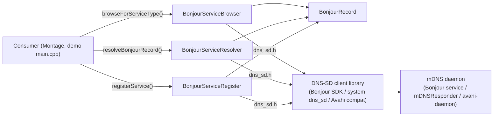

# AGENTS.md — qtbonjour

## Project snapshot

- Small Qt wrapper over Apple's DNS-SD (Bonjour) C API (`dns_sd.h`): browse for,
  register and resolve mDNS services, with results delivered as Qt signals.
- DisplayNote fork of `sikoragmbh/qtbonjour` (see [README.md](README.md)), maintained
  in `DisplayNote/qtbonjour`; Montage consumes it as the Conan package `qtbonjour`
  (Windows x86_64 only — see [docs/architecture.md](docs/architecture.md)).
- Stack: C++ / Qt 6 (6.8 LTS floor, `QT_DISABLE_DEPRECATED_BEFORE=0x060800`), qmake,
  Conan 1.x recipe (`conanfile.py`), Azure Pipelines via `qt-conan-ci` 2.4.0 (Qt 6.8.8,
  `msvc2022_64`). Licence: BSD-style, Trenton Schulz 2007 ([LICENSE](LICENSE)).

## Security

- NEVER suggest hardcoded credentials, API keys, or connection strings
- NEVER generate code that logs PII or sensitive data
- Flag any code that introduces new external dependencies
- Prefer established authentication patterns (OAuth2, JWT) over custom implementations
- Do not generate SQL without parameterised queries
- Flag any configuration changes that affect network exposure or access controls
- NEVER read raw log files or paste log content into a prompt — sanitise with `dn_logscrub` first (`/log-sanitise <file>`) and work only from the `.scrubbed` copy (AI Security Roadmap 4.7)

Repo-specific: service names, host names and TXT records handled by this library
describe devices on the customer's network (they can embed MAC addresses and device
names). Do not add log lines that print them; leave logging decisions to the
consuming app. See [docs/runbooks/debugging-with-ai.md](docs/runbooks/debugging-with-ai.md).

## Repository map

Flat layout — every source file is at the repo root.

| Path | What it is |
|---|---|
| `bonjourrecord.{h,cpp}` | `BonjourRecord`: service name, registered type, reply domain, TXT map; registers the `BonjourRecord` metatype |
| `bonjourservicebrowser.{h,cpp}` | `BonjourServiceBrowser`: `DNSServiceBrowse` for one service type, keeps the current record list |
| `bonjourserviceregister.{h,cpp}` | `BonjourServiceRegister`: `DNSServiceRegister` on a dedicated `QThread`, with TXT records and interface index |
| `bonjourserviceresolver.{h,cpp}` | `BonjourServiceResolver`: `DNSServiceResolve` → host name, port and TXT records |
| `qtbonjour.pro` | The library (static on Windows); the only project CI builds |
| `qtbonjour_app.pro`, `main.cpp` | Manual demo app that registers sample RAOP/AirPlay/"playmate" services; not built by CI |
| `conaninstall.pri` | Windows only: runs `conan install` from qmake to get the Bonjour SDK headers |
| `conanfile.py` | Conan 1.x recipe (requires `bonjoursdk/3.0.0@dn/stable` on Windows; packages `<os>/<BuildType>`) |
| `qtbonjour.pri` | Legacy include-the-source helper (`-L../qtbonjour -lqtbonjour`); not used by CI or the Conan package |
| `ci/azure-pipelines.yml` | Azure Pipelines definition (qt-conan-ci templates) |
| `docs/` | AI-agent docs: [architecture](docs/architecture.md), [runbooks](docs/runbooks/) |
| `.agents/skills/`, `.github/skills/` | Vendored `log-sanitise` skill (synced from `displaynote-engineering`; do not edit) |

## Run / build / test / lint

- Build: see [docs/runbooks/local-setup.md](docs/runbooks/local-setup.md) (Windows/MSVC
  with Conan is the only CI-verified path).
- Tests: there are none (no test project, no CI test stage). Manual check: build and run
  the demo app (`qtbonjour_app.pro`) — see the local-setup runbook.
- Lint/format: none configured.
- Release: tag-driven, documented in [README.md](README.md#ci-and-releases).

## Architecture overview

- `BonjourRecord` is the value type passed through every signal (a `QObject` subclass
  with a hand-written copy constructor and `operator=`).
- Browser and resolver run on the caller's thread: a `QSocketNotifier` on
  `DNSServiceRefSockFD()` drives `DNSServiceProcessResult()`.
- Register moves itself to its own `QThread` and calls `DNSServiceProcessResult()` once.

Details, data flows and platform support: [docs/architecture.md](docs/architecture.md).

## Coding conventions (observed)

- Everything lives in `namespace qtbonjour`.
- `Q_SIGNALS` / `Q_SLOTS` / `Q_EMIT` / `Q_FOREACH` macros, not the bare keywords (history:
  commits `bf54df6`, `d854b89`, `e705313`, `d1b297f`).
- Errors are reported as `DNSServiceErrorType` through an `error(...)` signal; there are no
  exceptions and no logging in the library apart from one fixed-text `qWarning`
  (`bonjourserviceregister.cpp:89`).
- Indentation is mixed (tabs in the upstream browser/resolver files, spaces in the
  DisplayNote-written register/record code). Match the file you edit.
- Preserve the upstream BSD licence header where a file has one (the upstream
  browser/register/resolver sources); some files, e.g. `bonjourrecord.cpp` and `main.cpp`,
  have none. Do not add or edit licence headers as a side effect of unrelated changes.
- Commit style on master: `AB#<work item> 
` (e.g. `653fa38`); PRs from
  `feature/<id>_<topic>` branches into `master`.

## Patterns to follow / anti-patterns to avoid

- Follow: callback → `static_cast` the `context` pointer → `Q_EMIT` a signal
  (`bonjourservicebrowser.cpp:70-89`, `bonjourserviceresolver.cpp:95-133`).
- Follow: keep the shared library entries of `SOURCES`/`HEADERS` in sync between
  `qtbonjour.pro` and `qtbonjour_app.pro`. Only `qtbonjour_app.pro` lists `main.cpp`; never
  add the demo entry point to the library project.
- Avoid: logging record contents, host names or TXT values (see Security).
- Avoid: calling `browseForServiceType()` twice on one browser — the previous
  `DNSServiceRef` is overwritten, not deallocated.

## Where to add X

| If you're adding… | Go to | Pattern |
|---|---|---|
| A new DNS-SD operation (e.g. query record) | new `bonjour<op>.{h,cpp}` at the root, plus both `.pro` files | Copy `BonjourServiceResolver`: socket notifier + static `DNSSD_API` callback + signals |
| A field on discovered/registered services | `BonjourRecord` (`bonjourrecord.h`) and its copy ctor / `operator=` | Every member must be copied in both (see `339d967`) |
| TXT record handling | `bonjourserviceregister.cpp:100-124` (write), `bonjourserviceresolver.cpp:109-129` (read) | |
| Platform link flags / SDK dependency | `qtbonjour.pro`, `conaninstall.pri`, `conanfile.py` | Keep the Conan profile name in `conaninstall.pri` equal to `conanProfiles` in `ci/azure-pipelines.yml` |
| CI change | `ci/azure-pipelines.yml` | Parameters of the qt-conan-ci templates only |

## Gotchas

- Qt 6.5 and 6.8 are not ABI compatible: a Qt 6.8 build must be released under a new
  version, never a rebuild of an existing one; 1.2.0 and earlier predate Qt 6.8 (README).
- `conaninstall.pri` runs `conan install` at qmake time and writes `conanbuildinfo.pri`
  into the source directory; qmake fails with `Error processing conan dependencies!!` if
  Conan, the `dn` remote or the `msvc19.x86_64.*` profiles are missing.
- The Conan profile is `msvc19.*` although CI builds with VS2022 — intentional.
- `TXTRecordSetValue` is given `QString::length()` (UTF-16 units) as the value length
  but the UTF-8 bytes as data (`bonjourserviceregister.cpp:109-112`): non-ASCII TXT values
  are truncated. The TXT buffer is a fixed 256 bytes.
- `BonjourServiceResolver` on a TXT parse failure emits `error()` with the original
  (success) `errorCode` and returns without deleting the record
  (`bonjourserviceresolver.cpp:118-123`).
- `BonjourServiceRegister` signals are emitted from its worker thread; connect with
  queued or auto connections.
- `qtbonjour.pri` adds `-ldns_sd` on every non-mac platform, which is wrong on Windows
  (`dnssd`); it is not part of the CI/Conan path.
- The demo app's `main.cpp` contains sample AirPlay TXT values (`pk`, `pi`); they are
  public-key / identifier samples for the demo, not credentials. Do not copy them into
  production code.

## Glossary

| Term | Meaning |
|---|---|
| DNS-SD / mDNS | DNS Service Discovery over multicast DNS (Apple Bonjour, Avahi) |
| Service type / regtype | e.g. `_airplay._tcp`; `BonjourRecord::registeredType` |
| Reply domain | Usually `local.`; `BonjourRecord::replyDomain` |
| TXT record | Key/value metadata of a service; `BonjourRecord::txtRecord` |
| RAOP | Remote Audio Output Protocol (AirPlay audio), `_raop._tcp` — used by the demo |
| qt-conan-ci | DisplayNote's shared Azure Pipelines templates for Qt + Conan libraries |

## External systems

| System | Role | Where configured |
|---|---|---|
| Bonjour SDK (`bonjoursdk/3.0.0@dn/stable`) | `dns_sd.h` and `dnssd` import library on Windows | `conanfile.py`, `conaninstall.pri` |
| mDNS daemon | Does the actual multicast traffic; must be running on the host | Outside the repo (OS / Bonjour service install) |
| DisplayNote Conan remote `dn` | Hosts `bonjoursdk` and the published `qtbonjour` packages | Conan client config / qt-conan-ci |
| Azure Pipelines + qt-conan-ci 2.4.0 | Build, version and publish | `ci/azure-pipelines.yml` (variable group `montage-client-environment-variables`) |

There are no tests, so nothing is mocked.
