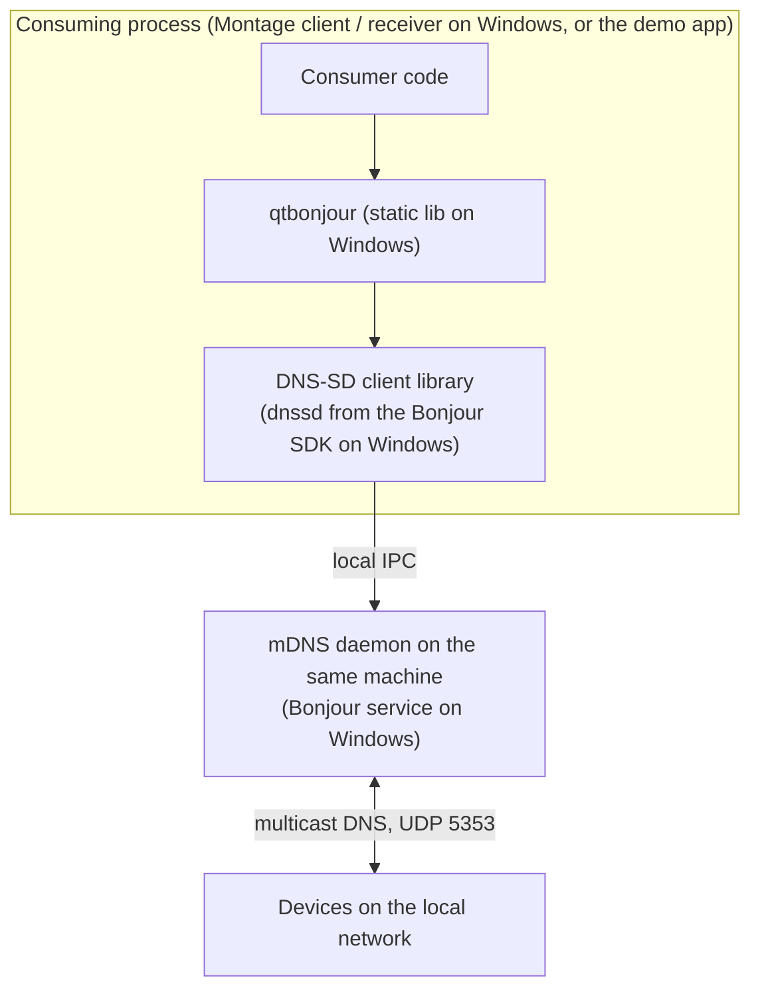

# qtbonjour — architecture

qtbonjour is four small classes over the DNS-SD C API (`dns_sd.h`). It has no I/O of its
own: every network operation is done by the platform's DNS-SD client library and mDNS
daemon, and results come back as Qt signals.

## Context

The daemon is not part of this repo or its package; on Windows it is the Bonjour service,
which must be installed on the machine separately.

## Components

| Class | Files | Public API | Threading |
|---|---|---|---|
| `BonjourRecord` | `bonjourrecord.{h,cpp}` | members `serviceName`, `registeredType`, `replyDomain`, `txtRecord` (`QMap<QString,QString>`); `operator==` compares the first three | Value type; metatype registered by a static initialiser in `bonjourrecord.cpp` |
| `BonjourServiceBrowser` | `bonjourservicebrowser.{h,cpp}` | `browseForServiceType(type)`, `currentRecords()`, `serviceType()`; signals `currentBonjourRecordsChanged(list)`, `error(err)` | Caller's thread (`QSocketNotifier` parented to the browser) |
| `BonjourServiceResolver` | `bonjourserviceresolver.{h,cpp}` | `resolveBonjourRecord(record)`; signals `bonjourRecordResolved(record, hostname, port)`, `error(record, err)` | Caller's thread; one `ResolveRecord` per pending resolve, keyed by socket fd |
| `BonjourServiceRegister` | `bonjourserviceregister.{h,cpp}` | ctor `(record, port, interfaceIndex)`, `registerService()`, `unregisterService()`, `registeredRecord()`; signals `serviceRegistered(record)`, `error(err)` | Moves itself to a new `QThread`; `registerService()` starts it, `onStarted()` registers |

## Data flows

1. **Browse**: `DNSServiceBrowse` (all interfaces, default domain) → socket readable →
   `DNSServiceProcessResult` → `bonjourBrowseReply` adds or removes a `BonjourRecord`
   (name, type, domain; no TXT) → when `kDNSServiceFlagsMoreComing` is clear, emits the
   whole list.
2. **Resolve**: `DNSServiceResolve(name, type, domain)` → reply converts the port from
   network byte order, parses every TXT item into `record.txtRecord`, emits
   `bonjourRecordResolved(record, hosttarget, port)` and deletes the pending entry.
3. **Register**: on the worker thread, builds a TXT record (256-byte buffer) from
   `txtRecord`, byte-swaps the port on little-endian hosts, calls `DNSServiceRegister`
   on the given interface index, then a single blocking `DNSServiceProcessResult`; the
   callback stores the final (possibly renamed) record and emits `serviceRegistered`.
   `unregisterService()` exits the thread; the `DNSServiceRef` is released in the
   destructor, which withdraws the registration.

## Platform support

| Platform | Header / library | Build files | Status |
|---|---|---|---|
| Windows x86_64 | `<dns_sd.h>` from Conan `bonjoursdk/3.0.0@dn/stable`; consumers link `dnssd64` from the same package (`conanfile.py` comment) | `qtbonjour.pro` (`CONFIG += staticlib`), `conaninstall.pri`, `conanfile.py` | The only platform built in CI and published |
| macOS / iOS | system `<dns_sd.h>`, no extra `LIBS` | `qtbonjour.pro` (default `PREFIX` only) | Not built in CI; per `ci/azure-pipelines.yml` Montage uses its own mDNS stack there |
| Linux | `<avahi-compat-libdns_sd/dns_sd.h>` (selected by `Q_OS_LINUX`), `-ldns_sd` | `qtbonjour.pro` `linux` scope | Not built in CI |
| Android | no Android-specific handling: Qt also defines `Q_OS_LINUX` on Android, so the headers ask for the Avahi compat header | default `PREFIX` only | Not built in CI; Montage uses its own mDNS stack there |

## Packaging and consumption

- `ci/azure-pipelines.yml` builds `qtbonjour/qtbonjour.pro` with the qt-conan-ci
  `windows-x86_64/build.yml` template and publishes with `common/deploy-develop.yml`
  (Conan profile set `msvc19.x86_64`). The demo app is not built.
- The package version comes from the git tag / PR number (README "CI and releases");
  `conanfile.py` has no `name`/`version`.
- `conanfile.py` `package()` copies the `<os>/<BuildType>` install tree (qmake `PREFIX`)
  and fails if it is missing; `package_info()` exposes every library in `lib/`.
- Montage's client and receiver consume the package as a Conan requirement; that pin
  lives in the Montage repo, not here.

## Active decisions

- Qt 6.8 LTS floor, enforced by `QT_DISABLE_DEPRECATED_BEFORE=0x060800` in both `.pro`
  files (AB#141677).
- Bonjour SDK headers come from Conan rather than a local SDK install, because CI agents
  have none (`conaninstall.pri`).
- Windows-only CI because Montage consumes qtbonjour on Windows only
  (`ci/azure-pipelines.yml`, README).
